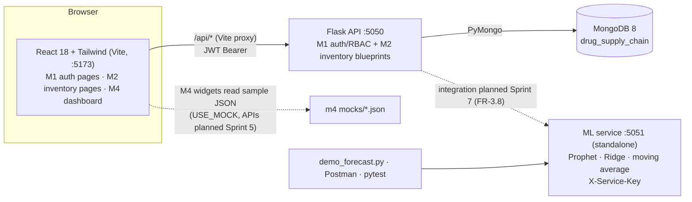

# AI-Based Drug Stock & Supply Chain Optimization

**Project ID:** 2026-27-AIML-28 · **SKIT Jaipur, Dept. of IT** · Session 2026-27

A web platform for a pharmacy chain (one central warehouse + pharmacy branches). It tracks drugs, stock
batches and sales, reduces stock **first-expiry-first-out (FEFO)** on every sale, raises purchase orders to
suppliers, and forecasts demand per drug and branch with **Prophet vs. scikit-learn regression**, picking the
model with the lower holdout MAPE. A role-based dashboard (admin / pharmacist / supplier) brings it together.
This repository is the **progress-demo build**: it matches the mentor's Form-3 Weekly Status Matrix
(last entry 24–25 Oct 2026). Features not yet due have a finished UI on sample data with a visible
"Sample data · planned Sprint N" badge.

| Member | Roll No. | Module | Folder |
|---|---|---|---|
| **Lucky Jangid** (Team Lead) | 23ESKIT091 | M1: User Authentication & Role Management, Flask backend & integration | [`m1_auth_lucky/`](m1_auth_lucky/README.md) |
| **Kunal Prajapat** | 23ESKIT086 | M2: Drug Inventory & Supply Chain | [`m2_inventory/`](m2_inventory/README.md) |
| **Kushagra Sharma** | 23ESKIT089 | M3: AI/ML Demand Forecasting & Risk Detection | [`m3_ml_kushagra/`](m3_ml_kushagra/README.md) |
| **Pranay Vaidh** | 23ESKIT124 | M4: Analytics, Visualization & Dashboard | [`m4_dashboard_pranay/`](m4_dashboard_pranay/README.md) |

## Architecture



Stack (fixed by the SRS): React 18, Tailwind CSS 3, Recharts, Chart.js · Python 3.11, Flask ·
MongoDB 8 via PyMongo · Flask-JWT-Extended + bcrypt · pandas, scikit-learn, Prophet.

## Milestone status

| Module | Form-3 | LIVE now | Sample data / planned |
|---|---|---|---|
| **M1 Auth** (Lucky) | **50 %** | users collection + unique email; register (bcrypt, 8-char rule, duplicate check); login JWT (id, role, exp); role decorators 401/403; `GET/PUT /users/me`; expired-token rejection + client logout; React Login/Register/Profile; auth wired into inventory | Security testing, admin user management (Users tab on sample data, **Sprint 4**) |
| **M2 Inventory** (Kunal) | **52 %** | drugs CRUD; suppliers; branches; stock batches (TC-04); FEFO sales with oversell rejection (TC-05); CSV upload with row rejection; purchase orders (create → Pending, list); supplier sees own orders | PO status workflow + delivered → stock (FR-2.7), supplier confirm/reject (FR-2.8): buttons disabled, **Sprint 4**; AI suggested orders panel, **Sprint 7** |
| **M3 ML** (Kushagra) | **35 %** | synthetic data; preprocessing; Prophet + Ridge with 80/20 MAPE selection; 14-day moving-average fallback; reorder formulas + tests; `POST /ml/forecast` service | `POST /ml/anomaly` returns 501 (**Sprint 6**); status/expiry/anomaly rules as pseudocode; backend integration (**Sprint 7**) |
| **M4 Dashboard** (Pranay) | **35 %** | dashboard shell, sidebar, filter bar, role-based navigation | KPI cards, heatmap, forecast chart, alerts & expiry, supplier performance, settings, reports (CSV export works): sample data, **Sprints 5–7** |

Sprint calendar (SRS Table 14): Sprint 4 = Nov–Dec 2026 · Sprint 5 = Jan 2027 · Sprint 6 = Jan–Feb 2027 · Sprint 7 = Feb–Mar 2027.

## Prerequisites
- **Python 3.11** (Prophet wheels exist for 3.11)
- **Node.js 20 LTS** or newer (npm included)
- **MongoDB 8**: local install (Windows service / Homebrew / apt) **or** Docker: `docker compose up -d`
- **Git**

## Setup

### Windows (PowerShell)
```powershell
git clone <repo-url> drug-supply-chain; cd drug-supply-chain
py -3.11 -m venv .venv
.\.venv\Scripts\Activate.ps1          # if blocked: Set-ExecutionPolicy -Scope CurrentUser RemoteSigned
pip install -r requirements.txt
npm install
Copy-Item .env.example .env
python scripts/seed_all.py --reset
```

### macOS / Linux
```bash
git clone <repo-url> drug-supply-chain && cd drug-supply-chain
python3.11 -m venv .venv
source .venv/bin/activate
pip install -r requirements.txt
npm install
cp .env.example .env
python scripts/seed_all.py --reset
```

**Prophet note:** if `pip install` fails on Prophet, install the rest and continue. The ML service still
runs (`prophet_available: false`) and falls back to regression and the moving average; Prophet tests skip.

`seed_all.py` is idempotent (run it as often as you like); `--reset` drops everything first;
`--with-sales` also loads the 240-day synthetic history (skip it if you want to show the CSV upload live).

## Run
Three terminals, each with the venv active, from the repo root:

| What | Command | Check |
|---|---|---|
| Flask API | `python -m m1_auth_lucky.backend.run` | http://localhost:5050/health → `{"status":"ok","db":"up"}` |
| ML service | `python -m m3_ml_kushagra.ml_service.app` | http://localhost:5051/health → `{"prophet_available":true,…}` |
| Frontend | `npm run dev` | http://localhost:5173 |

Or start all three at once: `scripts\run_all.bat` (Windows) or `./scripts/run_all.sh` (macOS/Linux).
Ports: 5173 / 5050 / 5051 / 27017 (5000 is avoided because macOS AirPlay uses it).

## Demo accounts
Password for every account: **`Demo@1234`** (the login page has one-click chips).

| Email | Role | Scope |
|---|---|---|
| `admin@demo.com` | Admin | everything |
| `pharmacist@demo.com` | Pharmacist | Malviya Nagar Pharmacy |
| `pharmacist2@demo.com` | Pharmacist | Vaishali Nagar Pharmacy |
| `supplier@demo.com` | Supplier | Rajasthan Pharma Distributors |
| `supplier2@demo.com` | Supplier | MedLine Wholesale |

## Demo script (about 3–4 minutes per member)
Start from a fresh `python scripts/seed_all.py --reset` with all three services running.

**Lucky (M1: Auth & RBAC, 50 %)**
1. Register a new pharmacist in the UI; show the validation errors for a duplicate email and a 7-character password.
2. In Compass/mongosh, show that `password_hash` is a bcrypt hash (TC-01).
3. Log in with a wrong password → error (TC-02). Log in correctly and show the JWT payload (role, exp) in the browser console or at jwt.io.
4. Log in as the pharmacist and open `/admin/settings` → 403 page. Run Postman TC-03 (403 JSON).
5. As `supplier2`, request supplier 1's PO in Postman → 403 (TC-12).
6. Edit the profile name. Log out, then show that an expired token is rejected (`JWT_EXPIRES_MINUTES=1`, or the test).
7. `pytest m1_auth_lucky -q`

**Kunal (M2: Inventory & Supply Chain, 52 %)**
1. As admin: add a drug, add a supplier with a lead time, view branches.
2. As pharmacist: add a stock batch (TC-04) and show it in the stock list with the days-to-expiry badge.
3. Record a sale that spans two batches (e.g. Paracetamol 500 mg, qty 50) and show the FEFO breakdown, earliest expiry first.
4. Try to sell more than is available → rejected, stock unchanged (TC-05).
5. Upload `m3_ml_kushagra/data/sales_history.csv` → saved count. Then upload `m2_inventory/sample_data/sales_history_with_errors.csv` → rejected rows with reasons.
6. Create a purchase order → Pending. Show the supplier seeing it in the Supplier Portal. Point out the disabled Confirm/Deliver buttons (Sprint 4).
7. `pytest m2_inventory -q`

**Kushagra (M3: Forecasting, 35 %)**
1. Start the ML service and open `/health` (Prophet available).
2. `python m3_ml_kushagra/scripts/demo_forecast.py` → the MAPE comparison table. Explain the 80/20 holdout and why the lower-MAPE model is kept. Point out the Insulin series falling back to the 14-day moving average.
3. Open the generated PNGs in `m3_ml_kushagra/outputs/`.
4. The script's SRS worked example: ROP 70, reorder 80. Then `pytest m3_ml_kushagra -q`.
5. Postman: `/ml/forecast` (200) and `/ml/anomaly` (501, contract agreed, Sprint 6). Show `rules_pseudocode.md` as the next step.

**Pranay (M4: Dashboard, 35 %)**
1. Dashboard Home: KPI cards, the colour convention and legend, latest alerts.
2. Heatmap: tooltips and the category filter.
3. Forecast Dashboard: actual vs forecast, MAPE + confidence (pick Cetirizine @ Jagatpura, MAPE > 25 %, to show "Low confidence").
4. Alerts & Expiry 30/60/90; Supplier Performance (Chart.js).
5. Reports: apply filters, then Download CSV.
6. Open `DASHBOARD_API_CONTRACT.md` and show how `USE_MOCK` switches to the real API in Jan 2027. Point out the "Sample data" badges.

## Running tests
```bash
pytest m1_auth_lucky m2_inventory m3_ml_kushagra -q
```
Backend tests use **mongomock** (no MongoDB needed). Prophet-specific tests skip if Prophet is not installed.

Postman (File → Import), run each collection's folder **0 · Login** first:
- `m1_auth_lucky/postman/M1_Auth.postman_collection.json`
- `m2_inventory/postman/M2_Inventory.postman_collection.json`
- `m3_ml_kushagra/postman/M3_ML.postman_collection.json`

Frontend: `npm run build` (production build) and `npm run lint`.

## API reference
- Auth, users, RBAC, error format: [`m1_auth_lucky/README.md`](m1_auth_lucky/README.md)
- Drugs, suppliers, branches, stock, sales/FEFO, CSV, purchase orders: [`m2_inventory/README.md`](m2_inventory/README.md)
- ML service: [`m3_ml_kushagra/contracts/ML_API_CONTRACT.md`](m3_ml_kushagra/contracts/ML_API_CONTRACT.md)
- Dashboard (agreed, not built): [`m4_dashboard_pranay/contracts/DASHBOARD_API_CONTRACT.md`](m4_dashboard_pranay/contracts/DASHBOARD_API_CONTRACT.md)
- Build brief used for this milestone: [`docs/BUILD_SPEC.md`](docs/BUILD_SPEC.md)

## Troubleshooting
| Symptom | Fix |
|---|---|
| `[startup error] Cannot reach MongoDB…` | Start MongoDB (Windows: `net start MongoDB` in an admin shell; macOS: `brew services start mongodb-community`; or `docker compose up -d`) and check `MONGO_URI` in `.env`. |
| `Address already in use` / port busy | Something else is on 5050/5051/5173. Windows: `netstat -ano \| findstr :5050` then `taskkill /PID <pid> /F`; macOS/Linux: `lsof -i :5050`. Ports can be changed in `.env` (`API_PORT`, `ML_PORT`); update the Vite proxy if you move the API. |
| Prophet fails to install | Use Python 3.11 and upgrade pip (`python -m pip install -U pip`). The service still runs without it. |
| CORS errors in the browser | Open the app at http://localhost:5173 (the Vite proxy forwards `/api` to Flask), not a built file. `CORS_ORIGIN` in `.env` must match the frontend origin. |
| "Session expired, please log in again" | The JWT expired (`JWT_EXPIRES_MINUTES`, default 60). Log in again. |
| "Cannot reach the server" toast | The Flask API isn't running on :5050. |
| PowerShell won't activate the venv | `Set-ExecutionPolicy -Scope CurrentUser RemoteSigned`, then `.\.venv\Scripts\Activate.ps1`. |

## Roadmap
| Member | Next deliverables | Hard deadline |
|---|---|---|
| Lucky (M1) | Security testing, admin user management, backend ↔ ML client | **15 Dec 2026** |
| Kunal (M2) | PO status workflow + delivered → stock batch (FR-2.7), supplier confirm/reject (FR-2.8) | **15 Dec 2026** |
| Kushagra (M3) | Anomaly detection (FR-3.7, Sprint 6), status/expiry rules (FR-3.5/3.6), integration + auto re-run (FR-3.8/3.9, 25 Feb – 5 Mar 2027) | **15 Mar 2027** |
| Pranay (M4) | Aggregation APIs (Jan 2027), alerts API, live forecast view, auto-refresh, settings save | **20 Mar 2027** |

All names, companies and figures in the seed and sample data are fictional.
